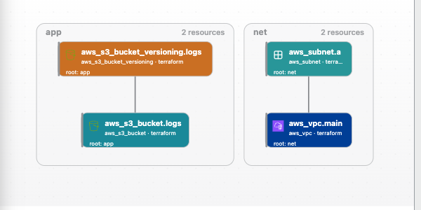

# behold

**Your infrastructure repo as a graph, from the files.**

```sh
npx @intentius/behold serve .
```

Run it in a folder of Terraform and it finds each root and draws it as a box of resources, with an edge for each reference the configuration states. It needs no state file or cloud account, and it runs no `terraform` binary. It writes nothing into the folder it reads. The same command draws a Pulumi program and the Kubernetes manifests in a plain directory, since their lexicons come with the install. behold works beside the tools a repo already uses.



The [documentation](https://intentius.io/behold/) covers each command and view in full. This README is the map.

## On every pull request

The GitHub Action in this repository comments a diagram of the resources a pull request changes and what they connect to. Each push edits the same comment, and the diagram also lands in the job summary with an SVG and JSON copy as artifacts. It reads the files in the repository and needs neither a plan nor cloud credentials.


```yaml
name: behold
on: pull_request
permissions:
  contents: read
  pull-requests: write
jobs:
  draw:
    runs-on: ubuntu-latest
    steps:
      - uses: actions/checkout@v6
        with:
          fetch-depth: 0
      - uses: INTENTIUS/behold@behold-v0.34.0
```

[action/README.md](action/README.md) lists the inputs and shows the GitLab and Forgejo forms.

## Print the graph: `behold graph`

`behold graph [dir]` reads a directory and prints its graph, with no server and no browser. A CI job, an editor or a script can take the output as it is. The directory can be a folder of `.tf` files, a chant project, a chant workspace root or a choudoufu estate.

```sh
npx @intentius/behold graph ./infra --json | jq '.nodes | length'
npx @intentius/behold graph ./infra --svg --theme light -o graph.svg
npx @intentius/behold graph ./infra --mermaid --forge gitlab
```

`--json` (the default) prints the `behold-graph/1` document, described on [the graph document](https://intentius.io/behold/using/graph-document/) page, with its schema in the package at `schemas/graph/v1/graph.schema.json`. `--ir` prints the unversioned `{ir, meta}` snapshot that `/api/graph` answers, without its SVG. `--svg` writes the picture as one self-contained SVG. `--mermaid` writes a Mermaid flowchart that fits the comment budget of the forge `--forge` names (github, gitlab or forgejo). No output holds an absolute path, and a card's source text is left out unless you pass `--source`. A root that does not parse is one card in the output, as it is in the browser.

Two cuts print part of the graph. `--changed <base>..<head>` keeps the cards added, removed or changed between two commits and the cards within `--depth` hops of them (default 1). Both commits are read with `git archive` into a temporary directory, so the checkout is not touched. Past `--budget` cards (default 60) the neighbours fold into a count per box. `--around <id>[,<id>...]` keeps the named cards or boxes and those within `--depth` hops, `--up` or `--down` for one direction.

```sh
npx @intentius/behold graph ./infra --changed origin/main...HEAD -o cut.json
npx @intentius/behold graph ./infra --around prod/prod/aws_vpc.main --depth 2
```

`--context <name>` draws a live Kubernetes cluster instead of a directory, through chant's read-only lister: API discovery, then a list per kind, a box per namespace and one for cluster-scoped objects. `--namespace` and `--types` narrow it. Nothing is written to the cluster. Add a directory (`--context prod ./infra`) and the folder is drawn in the same graph, with chant's reference catalog joining a ServiceAccount's cloud role annotation or an ExternalSecret's key to the Terraform that declares it, and the folder's `aws_eks_cluster` (or GKE or AKS cluster) to the context when its name matches. `--git <clone>` draws what the cluster's Argo CD Applications and Flux Kustomizations deploy from beside the live objects, read from a local clone with nothing fetched. `--index aws` joins the cloud index `behold index aws` wrote, so a ServiceAccount's role and an ExternalSecret's secret are drawn as the indexed resources. The cluster read also draws the edge from a Service to the Pods its selector picks, from an object to its owner, and from an EndpointSlice to its Service. `--logical` and `--components` group the objects by application, with each application's health ([the graph document](https://intentius.io/behold/using/graph-document/) has the views). A kubeconfig user that runs an exec plugin (the EKS, GKE and AKS command line tools write these) is refused unless you pass `--allow-exec-plugin`.

`behold graph --help` lists every flag.

## The graph in other tools

The same read feeds several places outside behold's own page. Each has a docs page or a README with the setup.

- A GitHub Pages workflow ([templates/github-pages.yml](templates/github-pages.yml), [docs](https://intentius.io/behold/using/pages/)) publishes `behold export` on each push to `main`, so the graph has a stable URL. It also writes `graph-dark.svg` and `graph-light.svg` beside the export, for a README to embed.
- Grafana's node graph panel draws a published `graph.json` through the Infinity data source, with two ready dashboards ([docs](https://intentius.io/behold/using/grafana/)).
- Backstage TechDocs can carry a component's graph as an image or a live frame ([docs](https://intentius.io/behold/using/techdocs/)).
- An `argocd-cm` entry gives annotated Argo CD Applications an "Open in behold" link, with nothing to install in Argo CD ([docs](https://intentius.io/behold/using/argocd-link/)).
- `kubectl behold` draws the current context, or one object and its neighbours, and opens the SVG. Install it with `kubectl krew install behold`; the current plugin is `0.1.1` ([surfaces/kubectl-behold](surfaces/kubectl-behold/README.md)).
- A Claude Code plugin registers `behold mcp` and a skill that starts `behold serve`: `claude plugin marketplace add INTENTIUS/behold`, then `claude plugin install behold@behold` ([plugins/claude-code](plugins/claude-code/README.md)).

## The served page

```sh
npx @intentius/behold preview                  # the current directory, source graph only
npx @intentius/behold serve . --env prod       # with the live drift overlay
npx @intentius/behold serve . --env prod --poll 30
```

`behold preview` opens a project's graph at one port with no env and no emulator. `behold serve` takes the same project and more: `--env <name>` colours each card by what is deployed, `--poll <secs>` re-reads live drift on an interval, and several project directories compose into one estate with a box per project and edges across them. The page is at http://localhost:4600 unless `--port` says otherwise.

The server watches the served source and pushes a refresh over SSE (`/api/events`) when a file changes, so the graph follows your edits with no reload. The panel offers zoom levels (components, logical, composites, resources, attributes, and the ops track and apply order where the project has them), a radial layout, an inspect pane and ⌘K search in chant's query grammar. [Reading the graph](https://intentius.io/behold/using/reading-the-graph/) explains the colours and marks.

With chant, behold draws every substrate of an estate in one graph (cloud drift on AWS, supply-chain drift on GitHub Actions, artifact presence on Helm, an Argo CD or Flux cluster) and starts the project's own committed, gated Ops. [Serve a chant workspace](https://intentius.io/behold/using/workspace/) and [Acting on it](https://intentius.io/behold/using/acting/) cover that path.

```
chant source --build/lint--> graph IR --behold--> live graph + drift + (delegated) actions
```

### Start from an agent

The docs start with a prompt that gets a coding agent with a shell to a running graph. Paste it into Claude Code, or any such agent, from anywhere:

```text
Clone https://github.com/INTENTIUS/behold and get me looking at a live
infrastructure graph in my browser.

I want the bundled demo. It needs Docker and no cloud account. Install what
it needs and start it, then tell me the URL.

Walk me through what I am looking at: what the colours mean, and how I make a
resource change colour while I watch.

When Docker is not running, say so. Show me the source graph on its own
instead.

For anything past the demo, read https://intentius.io/behold/llms.txt and
https://intentius.io/behold/using/agents/.

Never deploy with the Deploy button, `POST /api/apply` or `POST /api/ci/dispatch`. Gate approvals stay mine as well (`/api/ops/:name/signal/:gate`, `/api/workspace/gates/approve`, `/api/operator/approve/:op/:gate`). Op runs (`/api/ops/:name/run`) and rollbacks (`/api/rollback`) are mine too. Leave `--auto-sync` off, and keep a `behold preview` or `--public` serve read-only.
```

### Check a project first: `behold doctor`

```sh
npx @intentius/behold doctor [dir] [--json]
```

One line each for the project's kind, its own chant install and version, declared lexicons, which of them can be aimed at an emulator, the envs the picker will infer, the kube context chant binds against your ambient one, substrate readiness, committed Ops, the chant floor each read needs, and a line per non-chant member it found. Each is pass, warn or fail with a one-line fix. Nothing starts and nothing changes. The exit code is non-zero only when something would stop behold serving the project well, so CI can gate on it. `--fix` is the one form that writes: it writes `chant.workspace.json` for an estate root that still lists its members in `.behold.json`.

## Demos

```sh
npx @intentius/behold demo            # the default: one S3 bucket on a local emulator
npx @intentius/behold demo --list     # the catalog, with what each one needs
```

A bundled demo copies its project into a directory that is yours to edit, installs it and serves it. The default (`writes`) is an S3 bucket and its policy against a local Floci emulator in Docker: the cards start blue (declared), you click Deploy on the panel's Deploy tab, and they turn green (managed). With Docker stopped, behold serves the source graph and says why.

| Demo | Shows | Needs |
|---|---|---|
| `writes` | the first apply, on an emulator | Docker |
| `k8s` | an nginx Deployment on a throwaway k3d cluster: runtime Pods, field-ownership drift, an unobserved context | Docker, k3d, kubectl |
| `flux-estate` | a Flux control plane and two app projects composed into one estate | Docker, k3d, kubectl |
| `argo-estate` | the Argo CD version of the same estate, declared only | nothing |
| `terraform-estate` | a multi-root Terraform estate boxed by root, and the edge behold declines to infer | nothing |
| `carve` | a chant project beside a Terraform root, and the six-step carve walkthrough | nothing (`--live` needs Docker and terraform) |
| `choudoufu-estate` | four tag-owned estates as one workspace, coloured by ownership | Docker, choudoufu |
| `terralith` | one Terraform root adopted into choudoufu and split into team estates | Docker, curl, choudoufu |
| `three-cloud` | a website on AWS, Azure and GCP emulators behind Route 53, on three engines | Docker, curl, choudoufu, plunge |
| `fountain` | a real self-hosted app on k3d, cloned from INTENTIUS/fountain-ops | Docker, k3d, kubectl, jq, just |

Loaded demos land in the panel's recents, and the Scope tab lists the whole catalog. The walkthroughs are in [example-writes/README.md](example-writes/README.md), [example-k8s/README.md](example-k8s/README.md), [example-carve/README.md](example-carve/README.md) and the [three-cloud](https://intentius.io/behold/using/three-cloud/) page.

`serve --local` is the same mechanism for any project: it boots the served project's own emulators through `chant emulator up`, aims the live overlay at them, and tears them down on exit.

## Export a snapshot

`behold export` freezes the view into a static folder any static host can serve. Pan, zoom, the zoom levels, the radial layout, the inspect pane and the env and tier pickers all work with no backend; nothing live is observed and nothing deploys.

```sh
npx @intentius/behold export . --out ./behold-export
npx @intentius/behold export . --env prod --out ./behold-export   # with that env's overlay
npx @intentius/behold export . --single-file graph.html           # one HTML file
```

The bundle carries `graph.json`, the opening view as a `behold-graph/1` document, and a `wrangler.jsonc` for Cloudflare's static assets (`npx wrangler deploy` from the folder). It holds nothing about the machine that made it: no recent projects, no user name, and absolute paths cut to the directory's name. `--no-source` also leaves out each card's source text. `--open-env`, `--open-zoom`, `--note`, `--q` and `--count-by` set the opening view and the searches it answers offline. `--publish s3://<bucket>/<prefix>/views/<name>` uploads the bundle there, filed by commit. [Export a snapshot](https://intentius.io/behold/using/export/) has the rest.

## Index a cloud account: `behold index`

```sh
npx @intentius/behold index aws --account <id> --regions us-east-1,eu-west-1
npx @intentius/behold index kubernetes --context <name>
```

`behold index <aws|azure|gcp|kubernetes>` lists one account, subscription, project or cluster through that cloud's inventory API, types the result through chant, adds derived edges, and writes one stamped index version to the index store (by default `$XDG_DATA_HOME/behold`, else `~/.local/share/behold`; `--store` names another). It needs no project, starts no server and refuses every action flag. `behold index --help` lists the scope and filter flags. An aws index is typed by the optional peer `@intentius/chant-lexicon-aws`; install it beside behold, or the resources are kept as nodes of unknown kind.

The graph pane at `/graph` on a served page loads every member's IR, engine graph document, index version and cloud listing it finds into one read-only database, and answers Cypher queries and templates over it (`GET /api/graphdb/*`). The query side needs the optional peer `@ladybugdb/core`.

## Driving behold from an agent

`GET /api` on a running server lists the routes with a one-line description each. `GET /api/graph` answers `{ir, svg, meta}` and `GET /api/overlay?env=<env>` the live overlay; each node's `sourceLoc.file` is the source that declared it, and a failed precondition answers `{code, error, remedy}`. [AGENTS.md](./AGENTS.md), shipped in the package, is the read and act contract, and [Driving it from an agent](https://intentius.io/behold/using/agents/) is the long form.

`behold mcp [dir]` is a stdio MCP server for a coding agent:

```sh
claude mcp add behold -- npx @intentius/behold mcp <dir>
```

Its tools are `capabilities` (chant's capability catalog, to read first), `ask` (chant's search answer for a query, with a link to the view that draws it, or a read-only Cypher query over the graph pane), `show` (moves the open tab to a view), `shot` (a PNG of a view and its link) and `graph` (the repository or a cut of it, as an interactive view in a host that renders MCP Apps and as a summary with a Mermaid diagram elsewhere). It talks to the project's running serve when there is one. None of its tools deploys, approves, runs an Op, rolls back or writes.

`behold shot "<query>" [dir]` writes the same PNG from a shell. It needs the optional peer `playwright-core` and a browser.

To change the estate, an agent edits the chant source or runs a committed Op through chant's own MCP (`op-run`, `op-signal`, `op-status`). behold holds no apply credentials of its own.

## The write boundary

behold writes nothing in a served project, and writes nothing to a cloud or to your source itself. Its own state (hand layout, per-user settings, CI run ids, the serve registry) goes in your cache, home or temp directory, keyed by project. The exceptions are `behold doctor --fix` writing `chant.workspace.json`, the carve demo steps writing inside the demo copy behold made, and `behold export --publish`.

Every other write behold offers is a command it starts, run by a tool you already trust:

- Deploy starts the project's committed `ApplyOp`, and Adopt its `ReconcileOp` (which opens a pull request a person merges). Those run on your executor.
- On a project with no committed ApplyOp, Deploy runs `chant run <component> --components` as a child of behold, with the credentials of whoever started behold. Reading needs only read roles; deploying from behold needs write roles in that environment.
- An environment whose chant config names a forge executor is never applied from the laptop. Deploy dispatches that workflow through your `gh` login and follows the run.
- `behold export --publish` uploads the bundle it just made, only under a `views/<name>` prefix.
- In a terragucci repo (`terragucci.yml`) or a SQL Yodeler repo (`yodel.config.ts`), every write route answers 409 (`terragucci` or `sql-yodeler`) and the page offers none. Those repos are applied by their pipelines.

There is no route that applies a carve or moves a choudoufu resource.

## Serving behold to others

behold binds 127.0.0.1 and answers only loopback names, since it starts writes with the credentials of whoever ran it. `--allow-host <name>` (or `BEHOLD_ALLOWED_HOSTS`) adds a name a proxy forwards; `--host` binds another address.

`behold serve --public` is a read-only view for a host anyone may load. It builds no op runner, refuses every method but GET, HEAD and OPTIONS, refuses every read that runs a command or uses your credentials (the live overlay, plans, diffs, CI, doctor, the graph pane and more), and shows no control that writes. It serves one project and does not combine with `--env`, `--poll`, `--local` or `--auto-sync`.

The view is in the URL, so a reload keeps it and a link opens where the sender was:

```
http://localhost:4600/?member=delivery&zoom=components&env=prod&node=delivery/appService
```

The view keys include `member`, `zoom`, `env`, `tier`, `lens` (`drift`, `cost` or `headroom`), `node`, `radial`, `focus` and `q`. A host page frames behold with `?embed=1&host=<origin>` (and `bare=1` for the graph alone), receives `behold:select` messages when a card is picked, and moves the view with `behold:view`. A host that already watches the workspace sends `POST /api/refresh?notify=1` in place of `--poll`.

Gate approvals record who approved: `--as <principal>`, or the person a signing-in proxy names in the header `--identity-header` trusts, or the user running behold. A gate the workspace marks for signing is signed with `--signing-key`. [Approving a gate](https://intentius.io/behold/using/approving/) has the detail.

## Lanes for other tools

- `--terragucci <src>` marks each root of a [terragucci](https://intentius.io/terragucci/) repo with its newest `tf-drift` and `tf-plan` report and the waves waiting for approval, read from the reports bucket (a directory, `s3://` or `https://`). Every mark is dated by its run and links its report; nothing is read from a cloud. A waiting wave offers the `terragucci approve` line to copy. `/kiosk` follows terragucci's looping demo. See [terragucci](https://intentius.io/behold/using/terragucci/).
- `behold carve <report.json>` draws the report `chant carve advise` writes: one card per Terraform resource in three bands (carve now, boundary work, leave in Terraform), with the score arithmetic in the inspect pane. behold parses no HCL for it. See [the carve lens](https://intentius.io/behold/using/carve/).
- A Terraform estate draws as a member beside chant projects, read from the `.tf` files, with carve state from chant's `<address>.carve.json` manifests. See [Terraform](https://intentius.io/behold/using/terraform/).
- A choudoufu estate is coloured by ownership (bound, unowned, pending), with attribute drift as a separate plan read. See [choudoufu](https://intentius.io/behold/using/choudoufu/).
- `--yodel-report <file|dir>` marks a SQL Yodeler project with each environment's applied migrations, gaps and drift, from `yodel report --json`. behold never runs yodel or reads the database. See [SQL Yodeler](https://intentius.io/behold/using/sql-yodeler/).
- `--ci-report-url` and `--chant-report-url` read chant's CI run index and pull-request run events. See [the trunk lane](https://intentius.io/behold/using/trunk/) and [running a CI job locally](https://intentius.io/behold/using/local-run/).

## Configuration

behold keeps no config file of its own in a project. What it reads comes from chant:

- A chant workspace declaration (`chant.workspace.json`) lists an estate's members. Member kinds are chant, choudoufu, terraform and pulumi. A `.behold.json` with a `members` list is still read where no declaration exists; `behold doctor --fix` turns it into one.
- The tier picker comes from a `buildParams` entry with a string `enum` in `chant.config.ts` (the one named `tier`, else the first such entry). A picked tier reaches `chant graph` as `--param tier=<value>`, and the parameter's `env` variable is set for chant when it declares one.
- A forge executor for an environment is declared on that environment's entry in `chant.config.ts`, for example `{ name: "prod", executor: { forge: "github", workflow: "deploy-prod.yml" } }`. behold reads it through `chant workspace graph --composites`.

Per-user state lives outside the project, under `<user cache>/behold/` (`~/Library/Caches` on macOS, `%LOCALAPPDATA%` on Windows, `$XDG_CACHE_HOME` or `~/.cache` elsewhere; `BEHOLD_CACHE_DIR` moves it), keyed by a hash of the project's realpath. That holds the hand layout (the `{dx,dy}` and `{dw,dh}` offsets of cards you dragged and boxes you resized, which `behold export` bakes in) and the per-user settings (`approver`, `behaviour.traffic`). Dispatched forge runs are kept under `~/.behold/ci-runs/`, so a restarted behold picks up a run it was following.

## Reads and what they cost

behold runs the project's own chant, resolved from the project's `node_modules` first, so the project decides the chant version. `behold doctor` prints the chant floor for each read. A read whose floor the project's chant does not meet is refused, or read the older way, and says which floor it needs.

Every chant read shares one process-wide budget: two at once by default (one on a one-CPU host), `BEHOLD_ESTATE_CONCURRENCY` to change it, up to 64 waiting, and a 180-second deadline (`BEHOLD_READ_TIMEOUT_MS`). Identical reads in flight share one run, and a read with no callers left is cancelled. A member's source IR is cached by its source stamp, and its completed live overlay until a re-check, an Op run's capture or a source change drops it. `GET /api/doctor?reads=1` reports what each read cost, and `GET /api/overlay?progressive=1` streams the overlay member by member.

## Optional installs

Three peers are left out of a plain `npm install`. Each path that needs one stops with a line naming it.

| Peer | Used by |
|---|---|
| `@intentius/chant-k8s-client` | reading a kubeconfig on the served page: the context lookups, the kubectl context pills and `behold doctor` |
| `playwright-core` | `behold shot` and the `shot` MCP tool |
| `@ladybugdb/core`, `0.22.1` or newer | Cypher queries in the graph pane; `0.22.0` and earlier count multi-hop matches wrongly, so behold refuses them |

`behold graph` (including `--context`), `export`, `index` and `mcp` run without the Kubernetes client.

## Repository layout

```
src/
  cli.ts            the commands: serve, preview, demo, doctor, export, carve, graph, index, mcp, shot
  server.ts         the Hono API and the static page; every route reads or starts a delegated command
  read-graph.ts     the directory read behind behold graph, the action and the served page
  graph-*.ts        the graph document, its cuts, and the Mermaid and SVG formats
  read-cluster.ts   the bare cluster read
  behold-index.ts   behold index, over chant's runCloudIndex
  graph-db/         the graph pane
  mcp.ts            behold mcp
  chant.ts          shells the project's own chant; read-scheduler.ts budgets it
  workspace-reader.ts  every chant read goes through here
  estate.ts         members composed into one graph; member-kind.ts lists the kinds
  logical*.ts       one topology projection per substrate
  render.ts         the pinhole painter, IR to SVG, one pack per lexicon
  viewer/           the single-file and hosted viewer
web/                the page, unbundled ES modules
action/             the GitHub Action's code, and the GitLab and Forgejo forms
surfaces/           integrations that run inside other tools, such as kubectl behold
plugins/            agent plugins, such as the Claude Code one
templates/          the GitHub Pages workflow
docs/               the published site (Astro and Starlight)
demos.json          the shipped demo catalog
example-*/          the bundled projects the demos and e2e serve
e2e/                acceptance runs, one script per lane
```

The painter is [pinhole](https://github.com/INTENTIUS/pinhole), used as a library: the server lays out the IR with dagre and paints it to SVG, and the page wires click-inspect by `data-node-id`. Official marks (Kubernetes, Flux, Argo, Helm, and the cloud icon sets) are vendored under `web/icons/`, with licences in `THIRD_PARTY.md`. Themes are Ghostty terminal palettes run through an OKLCH token pipeline (`web/theme.js`).

## Local development

`just` lists every recipe. The core loop:

```sh
just install               # behold's own dependencies
just check                 # tsc, unit tests and build: the local gate
just example-install       # install the example project's chant (once)
just serve                 # serve example/ at http://localhost:4600
just serve example prod    # the same, with the live overlay (needs AWS credentials)
just example terralith-4   # serve one demo or workbench entry from this checkout
```

`serve` runs through `tsx` with no build step; for the built binary, `just build` then `./bin/behold.js serve <project>`. behold runs the served project's chant, falling back to its own only when the project has none, so install chant into the project you serve. `workbench.json` lists internal estates used in development, by path to sibling checkouts; it is not shipped, and an entry whose sibling is missing says so in `behold demo --list`.

`npm test` runs the unit tests, including in-process route tests against the real Hono app, with no cloud and no cluster. The `just e2e*` recipes run the acceptance scripts under `e2e/`; [e2e/README.md](e2e/README.md) lists their variables. The docs site has its own gate: `npm run build` in `docs/`.

[AGENTS.md](./AGENTS.md) has the rules for changing behold, and the [issue tracker](https://github.com/INTENTIUS/behold/issues) has its work.
