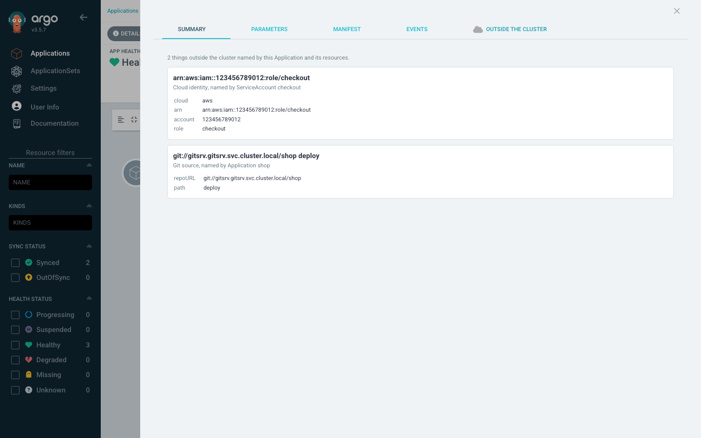
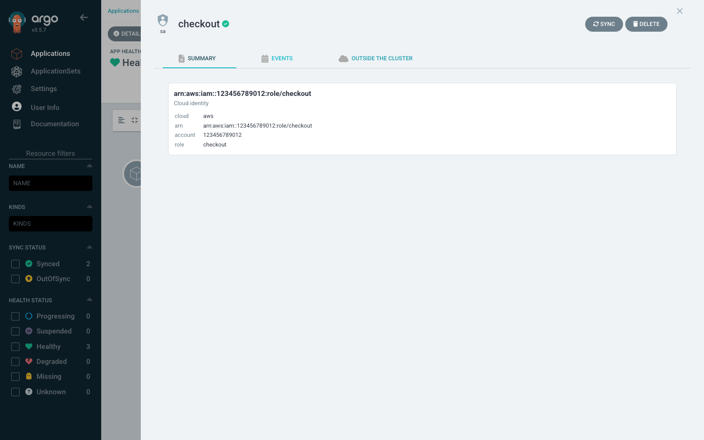

The extension adds one tab, "Outside the cluster", to Argo CD's Application
details panel and to the panel of each resource in the Application. It reads
the live objects through Argo CD's own API, applies behold's placeholder rules
and neighbourhood cut in the browser, and lists the results as cards. It needs
no behold server.



- On a ServiceAccount, the tab shows the cloud identity its annotation names (an
  `eks.amazonaws.com/role-arn` gives an IAM role card).
- On an ExternalSecret, SecretStore or ClusterSecretStore it shows the secret
  store and provider they name, and on a Flux Kustomization or GitRepository the
  Git source.
- On the Application, it lists every such card across the Application's
  resources, with the object that names each one, plus the Git source of the
  Application itself.
- On any other resource, it shows the cards within reach of that object, or says
  there are none.



The tab reads each object with the signed-in user's session, so it shows an
object only when that user may see it in Argo CD. It reads ServiceAccount,
ExternalSecret, SecretStore, ClusterSecretStore, Application, Kustomization and
GitRepository objects from the Application's resource tree and ignores the rest.

## Install

Argo CD loads a UI extension from `/tmp/extensions` in the `argocd-server` pod,
from a file named `extension*.js`. There are two ways to put the file there.
Both need Argo CD 3.5 or later: the extension is built against React 19 and
takes `react` and `react/jsx-runtime` from the host, as the Argo CD
[3.4 to 3.5 upgrade notes](https://argo-cd.readthedocs.io/en/stable/operator-manual/upgrading/3.4-3.5/)
describe. An Argo CD 3.4 or older does not provide `window.ReactJSXRuntime`.

### With the extension installer

Each release of `argocd-behold-v<version>` on GitHub holds
`argocd-behold-<version>.tar.gz` and `checksums.txt`. The
[argocd-extension-installer](https://github.com/argoproj-labs/argocd-extension-installer)
init container downloads the tarball, checks it against the checksum file and
unpacks it into the shared volume.

With the Argo CD Helm chart:

```yaml
server:
  extensions:
    enabled: true
    extensionList:
      - name: behold
        env:
          - name: EXTENSION_NAME
            value: behold
          - name: EXTENSION_VERSION
            value: 0.1.0
          - name: EXTENSION_URL
            value: https://github.com/INTENTIUS/behold/releases/download/argocd-behold-v0.1.0/argocd-behold-0.1.0.tar.gz
          - name: EXTENSION_CHECKSUM_URL
            value: https://github.com/INTENTIUS/behold/releases/download/argocd-behold-v0.1.0/checksums.txt
          # optional, see "A default export URL" below
          - name: EXTENSION_JS_VARS
            value: '{"export_url": "https://behold.example.com/api/graph?detail=3"}'
```

With kustomize, patch the `argocd-server` Deployment from the stock
`install.yaml`. The chart's `extensions` volume is an `emptyDir` mounted at
`/tmp/extensions`, and the patch adds the same:

```yaml
# kustomization.yaml
patches:
  - target: {kind: Deployment, name: argocd-server}
    patch: |-
      - op: add
        path: /spec/template/spec/volumes/-
        value: {name: extensions, emptyDir: {}}
      - op: add
        path: /spec/template/spec/containers/0/volumeMounts/-
        value: {name: extensions, mountPath: /tmp/extensions}
      - op: add
        path: /spec/template/spec/initContainers
        value:
          - name: extension-behold
            image: quay.io/argoprojlabs/argocd-extension-installer:v0.0.9@sha256:d2b43c18ac1401f579f6d27878f45e253d1e3f30287471ae74e6a4315ceb0611
            env:
              - {name: EXTENSION_NAME, value: behold}
              - {name: EXTENSION_VERSION, value: 0.1.0}
              - {name: EXTENSION_URL, value: "https://github.com/INTENTIUS/behold/releases/download/argocd-behold-v0.1.0/argocd-behold-0.1.0.tar.gz"}
              - {name: EXTENSION_CHECKSUM_URL, value: "https://github.com/INTENTIUS/behold/releases/download/argocd-behold-v0.1.0/checksums.txt"}
              - {name: EXTENSIONS_DIR, value: /tmp/extensions}
            volumeMounts:
              - {name: extensions, mountPath: /tmp/extensions}
            securityContext: {runAsUser: 1000, allowPrivilegeEscalation: false}
```

Use the installer tag your Argo CD chart carries if it is newer, and keep the
digest next to the tag. The `argocd-server` pod needs network access to the
release URLs; a mirror inside your network works if you point both URLs at it.

### With a ConfigMap

Where the pod cannot reach GitHub, put the built file in a ConfigMap and mount
it. The file is about 40 KB, well inside a ConfigMap's 1 MiB. Take
`extension-behold.js` from the release tarball (`resources/extension-behold.js/`),
then:

```sh
tar xzf argocd-behold-0.1.0.tar.gz
kubectl -n argocd create configmap behold-extension \
  --from-file=extension-behold.js=resources/extension-behold.js/extension-behold.js
```

and add to the `argocd-server` Deployment:

```yaml
spec:
  template:
    spec:
      volumes:
        - name: behold-extension
          configMap: {name: behold-extension}
      containers:
        - name: argocd-server
          volumeMounts:
            - name: behold-extension
              mountPath: /tmp/extensions/behold
```

Use one of the two ways, not both: a second copy registers a second tab.

## Check that it loaded

Open an Application and its Details panel. The "Outside the cluster" tab sits
after Events. If the extension fails to load, Argo CD says so in the browser
console as `Extension behold.js failed to load: TypeError: ...`. On Argo CD 3.5
that points to a build that bundles its own React JSX runtime; this extension's
build leaves it to the host, and the repository's test checks that.

## A default export URL

By default the tab reads only the objects Argo CD shows it. It can also read a
behold graph (a `behold export` file, or `behold serve`'s
`/api/graph?detail=3`), so that a target the graph already holds gets no
placeholder card. Two places give it the URL:

- the install default, from the installer's `EXTENSION_JS_VARS`, which the
  installer writes as `window.BEHOLD_VARS`; its keys are upper-cased, so
  `export_url` becomes `EXPORT_URL`;
- an Application annotation, which wins over the default:

```yaml
metadata:
  annotations:
    behold.intentius.io/export-url: 'https://behold.example.com/api/graph?detail=3'
```

The browser fetches the URL itself, so it must be served with CORS headers for
the Argo CD origin and over HTTPS when Argo CD is. A URL that cannot be read is
ignored and the tab works without it.

## Build and test it

The code is in `surfaces/argocd-behold`. It reuses the model of the Headlamp
plugin beside it (`surfaces/headlamp-behold/src/model.ts` and the copies of
`web/cut-around.js`, `web/neighbourhood.js` and `web/outside-refs.js` kept in
`src/behold/`), so a change to a placeholder rule reaches both.

    cd surfaces/argocd-behold
    npm ci && npm run tsc && npm test
    npm run build && npm run package

`just argocd-extension-e2e` creates a k3d cluster named `behold-argocd-ui`,
installs Argo CD v3.5.7 in full (not `core-install`, which has no UI), installs
the extension through the installer, syncs an Application from a git
repository served inside the cluster and drives the UI in Chrome. It leaves the
cluster running.

## Listing and releases

Argo CD keeps no catalog of extensions, so a user installs this one as above.
Publishing is a maintainer step: push the tag `argocd-behold-v<version>`, which
runs `.github/workflows/argocd-extension-release.yml` and attaches the tarball
and `checksums.txt` to a release. Any public listing, such as a link from the
Argo CD extensions page or an `argoproj-labs` repository, is a separate
request to that project.
