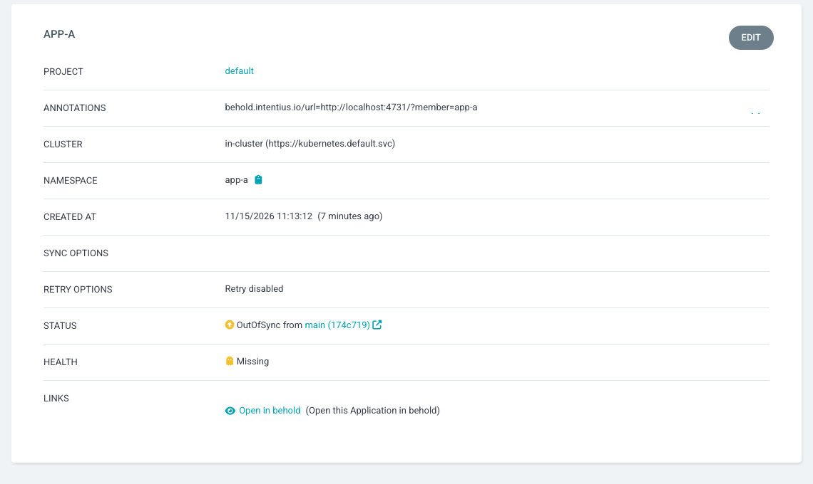

import { Aside } from '@astrojs/starlight/components';

Argo CD can add links to its Application and project views from configuration
alone (its [deep links](https://argo-cd.readthedocs.io/en/stable/operator-manual/deep_links/)).
One entry in `argocd-cm` gives each Application that carries a behold URL an
"Open in behold" link. There is nothing to install in Argo CD.



## The configuration

Add this to the `argocd-cm` ConfigMap:

```yaml
data:
  application.links: |
    - title: Open in behold
      url: '{{ index .app.metadata.annotations "behold.intentius.io/url" }}'
      description: Open this Application in behold
      icon.class: fa-solid fa-eye
      if: app.metadata.annotations["behold.intentius.io/url"] != nil
  project.links: |
    - title: Open in behold
      url: '{{ index .project.metadata.annotations "behold.intentius.io/url" }}'
      description: Open this project in behold
      icon.class: fa-solid fa-eye
      if: project.metadata.annotations["behold.intentius.io/url"] != nil
```

Argo CD reads `argocd-cm` as it changes, so an edited link shows up without
restarting `argocd-server`.

## The annotation

An Application gets the link when it carries `behold.intentius.io/url`, whose
value is the behold URL to open:

```yaml
apiVersion: argoproj.io/v1alpha1
kind: Application
metadata:
  name: app-a
  namespace: argocd
  annotations:
    behold.intentius.io/url: 'https://behold.example.com/?member=app-a'
```

The link is in the Links row of the Application's Details, on the Summary tab.
An Application without the annotation shows no link. The same annotation on an
AppProject gives that project's page the link, through `project.links`.

To open a member, use `?member=<name>`, the name the member has in the served
`chant.workspace.json` (for the example estate, `app-a`, `app-b` and
`control-plane`). `node=<member>/<id>` brings one card forward, and `zoom`,
`env` and `lens` choose how the graph is drawn. The view keys are listed in
`web/view-url.js` (`VIEW_KEYS`) and behold settles them against what it serves:
a `member` it does not know is dropped and the estate opens whole. A URL with
no query opens the estate as behold would open it.

## What the link variables allow

Argo CD gives each location its own variables. `application.links` offers
`app` (also `application`) and `cluster`, and `project.links` offers `project`.
A link in `application.links` that names `project` fails to evaluate: Argo CD
logs the error and returns no links for that Application, including the
valid ones. So the project level default is the `project.links` entry above,
which shows on the project page. An Application's own link comes from its own
annotation.

An annotation key with dots or a slash is written differently in the two
places. In `url`, a Go template, use `index` with the quoted key:
`{{ index .app.metadata.annotations "behold.intentius.io/url" }}`. In `if`, an
expression, use brackets: `app.metadata.annotations["behold.intentius.io/url"] != nil`.
Both forms are what the Argo CD documentation shows for labels, and both work
on an annotation key.

## What the target must be

The link goes to a behold the person clicking can reach. Two shapes work:

- A shared `behold serve`, started with `--host` and `--allow-host` for the name
  people reach it by (see `behold serve --help`). Add `--public` for a
  read-only view.
- A published static [export](/behold/using/export/). It opens the same
  `?member=` and `?zoom=` links against the views it captured.

A published export of a private repository is visible to everyone who can
reach the host it is published to. Put it behind the same access control as the
repository, or share the served form instead.
